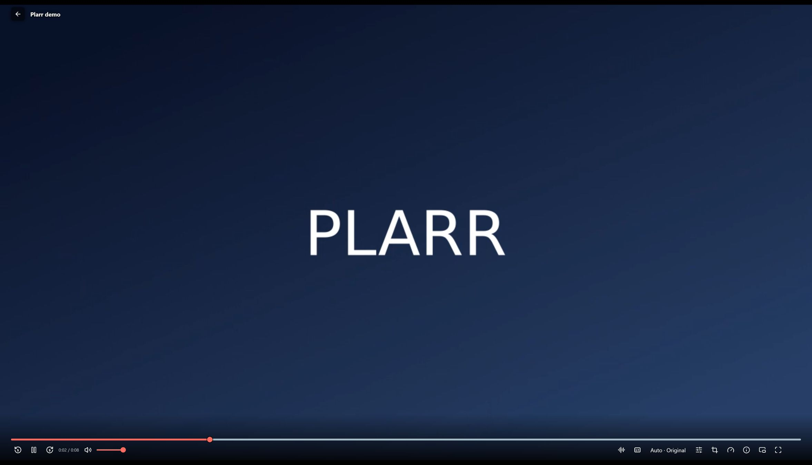
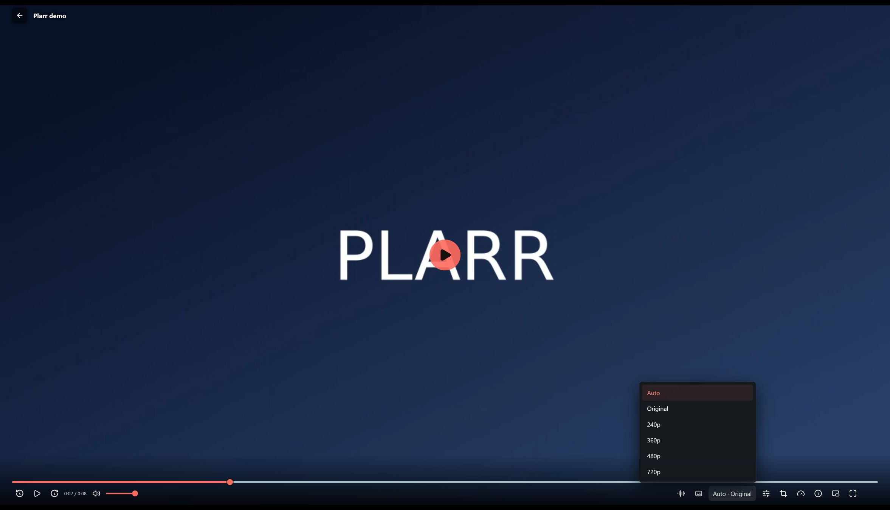

# Plarr

### Your videos, ready for the screen you're on.

Plarr is a self-hosted video player for your own media. Open a film or episode in your browser, let quality adapt to your connection, or send it to a Chromecast—no app to install on the TV.



## The viewing experience

- **Keep the original when it works.** Plarr plays compatible files directly and remuxes or converts them when compatibility or your chosen quality calls for it. The original file is always available to download unchanged.
- **Let quality follow your connection.** Auto chooses a suitable stream; you can switch to a specific resolution or the original whenever you want.
- **Watch HDR your way.** Keep HDR, let Plarr choose, or switch to SDR with tone mapping when the source and your display call for it.
- **Make playback yours.** Choose audio and subtitles, preview the timeline, adjust speed, crop away baked-in black bars, and tune brightness, contrast, saturation, and gamma.
- **Take it to the TV.** Cast to a Chromecast with Google's built-in receiver—nothing to install on the television.
- **Bring your own library.** Plarr runs independently. Optional playback grants protect individual files when access control is needed, and it can also serve as the player for [Nestrr](https://github.com/victor141516/Nestrr)'s catalog and accounts.



*Screenshots are from a running Plarr instance playing a generated demo clip; no personal media is included.*

## Try it in a few minutes

You need Docker and a folder of videos. From this repository:

```bash
docker build -t plarr .
docker run -d --name plarr -p 8090:8090 \
  -v "/absolute/path/to/videos:/media:ro" -v plarr-cache:/cache \
  -e PLARR_MEDIA_ROOT=/media \
  -e PLARR_CACHE_DIR=/cache \
  -e PLARR_PUBLIC_ORIGIN=http://localhost:8090 \
  plarr
```

Replace `/absolute/path/to/videos` with your library path. If that folder contains `sample.mp4`, open [Plarr's sample-file URL](http://localhost:8090/#/play/c2FtcGxlLm1wNA) on the same computer. Plarr does not move or alter your media.

For Windows commands, other filenames, NVIDIA/Intel/AMD acceleration, Nestrr integration, access control, and Chromecast setup, see the [installation guide](docs/INSTALLATION.md).
